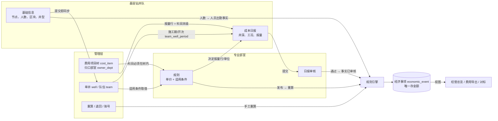

# 管理层 · 基层钻井队 · 专业部室：逻辑关系与勾稽关系

依据代码（`backend/app`）与《主逻辑线》梳理，截至 2026-10-16。结论先行：三方不直接对话，**只通过三张“交接物”衔接**，最终在经济事项表汇合。

> 主线：专业部室管“价”，基层队管“量”，程序算“钱”，管理层管“底座与口径”。

> **2026-10-16 调整：取消专业部室审核。** 专业部室不再是系统角色，只把合同、补充协议、制度、调价通知等变化依据交给管理层；规则由管理层维护（确认 → 影响预览 → 登记依据发布 → 有误回滚），成本日报提交时系统校验通过即生效，有警告的由管理层在「日报监控」抽查，可退回更正或冲销退回。下文“专业部室”一栏描述的是调整前的分工，规则与日报相关的勾稽关系不变，只是审核关口由人工换成了系统校验 + 事后抽查 + 可回滚。

## 一、三层各自的“地盘”

| | 管理层（企划财务部，`finance`） | 基层钻井队（`team`） | 专业部室（`dept`） |
| --- | --- | --- | --- |
| 管什么 | 底座与口径：费用项目树、单井、队伍、分摊 | **量**：发生了什么、多少 | **价**：依据文件 → 条款 → 规则 |
| 写入的表 | `cost_item`、`team`、`well`（含批量导入）、`app_user` | `well_info_report`（基础信息）、`daily_report` → `business_fact` | `source_doc`、`clause`、`economic_rule`、`rule_condition` |
| 审核/确认 | 退回基础信息、触发重算 | 提交即生效（基础信息）；日报提交待审 | 审核日报；确认→回算→发布规则 |
| 数据范围 | 全部 | 本队的井（`team_well_period`） | 归口科目（`owner_dept`），**看不到收入** |
| 不能做 | 不能手改金额 | 看不到、也不填金额 | 不填事实，不碰其他部室科目的规则 |
| 默认首页 | 经营总览 | 成本日报 | 规则确认 |

代码落点：菜单与权限矩阵 [auth.py](../backend/app/auth.py)；行级过滤 `visible_wells`（按队）、`item_visible`（按部室归口、剔除收入）。

## 二、逻辑关系：谁给谁什么

三条“交接物”：

1. **底座（管理层 → 全员）**：井号是唯一身份码；`team_well_period` 记录“哪队、哪段时间、哪个开次”。基层的基础信息一提交，系统自动改写这张表（[wellinfo.py `_apply`](../backend/app/wellinfo.py:391)），随后：
   - 日报表头（队伍、区块、开次）从这里取；
   - 规则的适用条件（市场/区块/井型/开次/队伍/钻机型号）也从这里取值（[engine.py `well_context`](../backend/app/engine.py:19)）。
   所以**基础信息是基层与部室之间的“公共语言”**：基层填错一个区块，部室的规则就会套错价。
2. **报量行（部室 → 基层）**：日报要报哪些量，由“该井当天有效的已发布规则”决定（[reports.py `line_defs`](../backend/app/reports.py:48)）。规则增减，日报行自动增减，单位取规则计价单位。无规则的量也能报，会提示“未匹配规则”，推回归口部室补规则。
3. **已审核事实（基层 → 引擎）**：日报经部室审核后事实才生效，引擎才会计价（[reports.py `approve`](../backend/app/reports.py:289)）。

## 三、勾稽关系（可核对的等式与约束）

### A. 同一数据的跨层对应（“这里填的 = 那里用的”）

| # | 勾稽 | 左边 | 右边 | 校验/保证位置 |
| --- | --- | --- | --- | --- |
| A1 | 井号唯一 | 基础信息井号 | `well`、事实、事项、日报全部以此关联 | 已被他队登记则阻断（`wellinfo.validate`） |
| A2 | 施工期 | 基础信息节点（搬安、开钻k、完钻、完井） | `team_well_period` 的队伍–井–开次–起止 | `_segments` 推导；日报“当天不在这口井施工期”阻断 |
| A3 | 开次 | 基础信息设计开次 n | 节点只能填到第 n 开；二开前须有一开完钻 | `wellinfo.validate` 阻断 |
| A4 | 日报进尺 | 结束井深 − 起始井深 | 事实“进尺”；`well.actual_depth` = 已审核日报最大结束井深 | `facts_from_report`、`approve` |
| A5 | 工况 | 各工况小时合计 = 24 | 事实“工况时间”；有进尺必有钻进工况 | 阻断 |
| A6 | 日历天 | 每张日报 1 队天 | 事实“日历天”（系统接口生成） | `facts_from_report` |
| A7 | 人工费 | 基础信息的合同化/市场化/第三方人数 | 日报生成当日“人员出勤”事实（来源=基础信息），人工费/伙食费/补贴按此核算 | `staff_on` 取当天最后提交版本；无人数则警告 |
| A8 | 外包服务与工况 | 固井/测井/下套管/钻进服务量 | 对应工况小时必须 > 0；有该工况必须报服务 | 警告（双向） |
| A9 | 外包服务与单据 | 服务量 | 必须填签证单号 | 阻断 |
| A10 | 物资/报量项 | 报量项目编码 | 必须在 `report_line` 字典、对应末级费用项目 | 阻断 |
| A11 | 用量合理性 | 本日用量 | 不超同开次已审核历史均值 × 1.3（≥3 条样本）；单日进尺 ≤ 300 米；补报 ≤ 7 天 | 警告（审核重点） |

### B. 规则 ↔ 费用项目 ↔ 部室（价的口径闭环）

- 每条规则 `item_code` 必须挂在费用项目树上；规则的“归口”= 该科目的 `owner_dept`，部室**只能看/改本归口规则**（`rules._visible/_can_edit`）。管理层只读。
- 规则状态：草稿 → 待确认 → 回算中 → 待发布 → 已发布（→ 已被替代）。确认时先做冲突检查（同科目、同条件、同优先级的互斥规则不能重叠），再回算：与历史导入金额（总表）逐井比对，偏差 ≤ 5% 通过，无历史井则豁免。
- 已发布规则的价格、条件、科目、事实类型、生效日由数据库触发器锁死：**只增不改**。调价 = 新版本；旧版失效日 = 新版生效日 − 1。
- 比例计提（calc_order 3）以收入等基数项目为底，**基数变动时自动联动重算**。

### C. 事实 + 规则 → 事项 → 报表（金额链条）

1. 事项键：`(事实, 规则)` 或 `(期间, 比例规则)`。重算时只比对差异：金额不变保留，变了就**负数冲销 + 新建**（`reversal_of` 指回原笔）。
2. **有效金额恒等式**：任意井、科目、期间，`SUM(amount)`（有效 + 冲销 + 已冲销三类求和）= 当前应有金额；被冲销的原笔与冲销笔互相抵消。
3. 经营总览、单井结果、费用导出、对标分析**全部由 `economic_event` 汇总，不另存金额**。测试 `test_every_dimension_reconciles_with_overview` 保证费用导出按时间/市场/区块/队伍四个维度分别合计，都与经营总览一致。
4. 经营指标：收入 R02；固定成本 C1；变动成本 C2；总成本 = C1 + C2；毛利 = 收入 − C2；净利 = 收入 − C1 − C2（`analysis.compute`）。
5. 部室视图勾稽：部室合计 = 归口科目之和，不含收入；因此部室与管理层的差额 = 非归口科目 + 收入。
6. 历史导入科目以导入金额为准，引擎不再对该科目、该井、该月重复计算（防双算）。

### D. 变更联动（改一处，哪里跟着动）

| 触发 | 联动 |
| --- | --- |
| 日报审核通过 | 事实置“已审核” → 更新 `well.actual_depth` → 该井该月重算 |
| 日报更正（审核后） | 新版本审核通过时：原日报“已被更正”、原事实“已冲销” → 重算（冲销原事项） |
| 日报驳回 | 删除其“已提交”事实，基层改后重提 |
| 规则发布 | 生效月起所有受影响井月份重算（批次记录“规则新版本发布”） |
| 基础信息变更 | 重写 `team_well_period`/里程碑 → 该井已审核月份重算 |
| 管理层退回基础信息 | 生成带原因的草稿，队伍改后重提 |
| 删除井 | 冲销该井全部有效事项并登记 `well_deleted`，各页面隐藏；重新登记即恢复 |

每次重算写一条 `calc_batch`（触发原因、范围、新增/冲销笔数、金额变化），可在“历史记录”页追溯。

### E. 每笔钱的追溯链

事项 → 规则版本（`rule_id`）→ 条款 → 依据文件原文页码；事项 → 事实（`fact_id`）→ 日报版本/填报人/审核人 → 单据号。比例计提类追溯到基数事项。三层的操作人都落在 `approval_log`。

## 四、权限与勾稽的交叉点：三层各自看到什么

| 数据 | 管理层 | 基层队 | 专业部室 |
| --- | --- | --- | --- |
| 收入 | ✓ | ✓（本队井） | ✗ |
| 成本科目 | 全部 | 全部（本队井） | 仅归口 |
| 规则/单价 | 只读 | 日报页不见金额 | 本归口读写 |
| 日报 | 只读（审核队列可看） | 本队读写 | 审核 |
| 基础信息汇总 | 编辑（导入/退回） | 本队填报 | ✗ |
| 费用导出 | ✓ | ✗ | ✓（归口，无收入） |
| 对标分析 | ✓ | ✗ | ✗ |

## 五、梳理中发现的需确认事项

前三条已在后续改动中处理，保留作记录：

1. ~~日报审核没有按归口过滤~~ **已处理**：部室只看到、只能审涉及本部室归口科目的日报（进尺与工况归技术，所以技术部室看到全部日报；其余部室按日报里有数量的报量项目所属科目归口）。同一张日报涉及多个部室时，任一涉及部室都可通过或驳回，先到先审。
2. **基层看得到单价（待定）**：日报页不显示金额，但 `item_events`/`trace` 接口对基层开放，会返回单价、规则条件。若坚持“量价分离、基层不见价”，需在接口层按角色裁剪。
3. ~~管理层不能发布规则~~ **已处理**：规则回算达标进入“待发布”后，管理层可审批发布（日志标注“管理层发布”）；确认、修改、驳回、调价新版本仍只属归口部室。
4. **分摊部分实现**：折旧、长摊、项目部运行费用、制造费四类科目可在“费用分摊”页录入月度费用池，按队天或进尺分到队、到井，写入“分摊”类事项，取代该井该月同科目的规则计算，可作废恢复；其余间接费用、多级分摊、待命期去向仍未实现。
5. **预算、结算、财务三方比对**文档已明确放到下一阶段，目前没有对账表，勾稽主要靠“同源汇总”而非“跨系统比对”。

---
附：关键代码位置
[auth.py](../backend/app/auth.py) 权限与行级过滤 · [reports.py](../backend/app/reports.py) 日报校验与事实生成 · [wellinfo.py](../backend/app/wellinfo.py) 基础信息与施工期 · [rules.py](../backend/app/rules.py) 规则生命周期 · [engine.py](../backend/app/engine.py) 引擎与冲销 · [analysis.py](../backend/app/analysis.py) 汇总与溯源 · [schema.sql](../backend/app/schema.sql) 表结构与触发器
