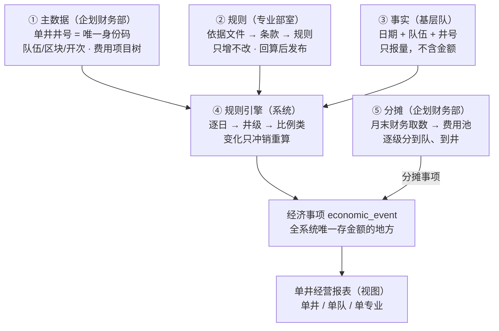

# 钻井单井经营管控系统 主逻辑线

2026-10-12 · Stephen Fung（导出自在线文档，在线版本：https://claude.ai/code/artifact/d7795e43-91d8-48bd-8150-ccc51fbe2a56）

主线只有一条：**专业部室管“价”，基层队管“量”，程序算“钱”**；所有金额只落在经济事项一张表，单井经营结果直接从这里汇总。本版先走通“算对”主线，预算、结算、财务三方比对放到下一阶段。

## 一图看懂

①②③ 三条输入线由引擎汇成经济事项，⑤ 分摊补入间接成本，报表直接从事项表汇总。

## 主线五步

五步走通即可算出单井经营结果。每一步只有一个牵头部门，产出物是下一步的唯一输入。

1. **打底座：以单井井号为核心的主数据**（企划财务部牵头）
    - **单井井号是唯一身份识别码**：事实、事项、预算、结算全部以井号关联。
    - 队伍、区块、井型、设计井深、开次、甲方单位等作为**单井基础信息**挂在井号下，按时段记录（如每个开次由哪支队伍施工）。
    - 费用项目树 cost_item：收入、成本一棵树，标明归口部室、直接/间接、对应会计科目，并标明“按规则算”还是“按财务实际取数”。
    - 单井的收入、成本科目**只与规则库适配计算**，不直接挂合同；合同只作为规则的来源依据，由规则适用条件去匹配单井基础信息。
    - 产出：所有后续步骤引用的编码和口径。
2. **定价格：依据文件 → 条款 → 规则**（各专业部室，按归口费用项目）
    - 合同、制度、定额入库；AI 拆条款、提规则草稿；部室逐条确认（流程见下文“规则维护流程”）。
    - 每条规则写清：触发事实、计价方式、适用条件（匹配单井基础信息：区块、井型、开次、队伍、甲方等）、与同项目其他规则是**互斥还是叠加**、计算粒度（逐日 / 按井累计 / 按阶段 / 按期间）。
    - 以规则集为单位用已结算井回算，达标后发布；只增不改。
    - 产出：已发布规则库。
3. **写事实：基层只报“发生了什么、多少”**（钻井基层队）
    - 按“日期 + 队伍 + 井号”填报进尺、日历天、工况、材料、台时、外包服务等，不含金额；统一通过成本日报填报（见下文“基层填报入口”）。
    - 系统交叉校验（工况、合理范围、单据识别），阻断级不处理不能提交；部室审核。
    - 审核后需更正的，冲销原事实再新报，保留关联。
    - 产出：已审核业务事实。
4. **算金额：规则引擎生成经济事项**（系统）
    - 事实审核通过、规则发布、月末、手工重算四种触发。
    - 按顺序计算：逐日规则 → 累计/阶梯/包干/奖罚等井级规则 → 比例类规则（以前面结果为基数）。
    - 每笔事项记录来源事实（可多条）、规则版本、条款和计算快照；变化只冲销重算。
    - 规则算不了的，部室人工计价，审批后入表并单独标识。
    - 产出：直接收入与直接成本事项。
5. **归间接：费用池分摊到井**（企划财务部）
    - 月末财务取数形成费用池，按分摊规则逐级分到队、到井（含待命期的去向）。
    - 分摊结果作为“分摊”类事项写入同一张事项表，尾差归最后一口井或指定对象。
    - 产出：完全成本口径的单井事项；单井、单队、单专业报表均为事项表的视图。

## 规则维护流程

规则库按“一套主流程 + 三种触发 + 日常监控”维护：规则与收入、成本科目一一对应，适用条件只匹配单井基础信息。

### 主流程：从文件到已发布规则

| 步骤 | 做什么 | 谁做 | 卡控点 |
| --- | --- | --- | --- |
| 1 文件登记 | 上传原件，录入文件类型、对方单位、生效期，以及主合同/补充协议关系 | 归口部室经办人 | 记录文件指纹，防止原件被替换 |
| 2 AI 解析 | 拆条款（原文 + 页码），提取规则草稿：科目、触发事实、计价方式、单价与参数、适用条件、互斥/叠加、计算粒度，附置信度 | 系统 | 写不成公式的条款标为人工计价 |
| 3 人工确认 | 原文与草稿左右对照，逐条确认或修改；每条规则挂到一个费用科目 | 归口部室经办人 | 置信度低于阈值强制逐字对照 |
| 4 自动检查 | 同科目、同条件、同时段是否重叠；条件值是否存在于单井基础信息；计价单位与事实单位是否一致 | 系统 | 有冲突不能进入下一步 |
| 5 回算测试 | 以规则集为单位，用已结算井按“井 + 科目”比对金额 | 系统出结果，部室解释偏差 | 超阈值退回第 3 步；无历史井走豁免审批 |
| 6 审批发布 | 生成新版本，设定生效日 | 部室负责人 | 追溯生效的，系统圈出重算范围，经企划财务部确认后执行 |

规则状态流转：草稿 → 待确认 → 回算中 → 待发布 → 已发布 → 已被替代 / 已废止；任一步驳回退回草稿。

### 三种触发

1. **新合同、新制度入库**：完整走一遍六步。
2. **调价、补充协议、制度修订**：旧规则不动，复制为新版本草稿，只改变化的参数；系统展示新旧差异，再走第 4–6 步。
3. **合同到期或废止**：到期前 30 天提醒归口部室；未续签的规则到期自动失效。

### 日常监控

企划财务部每月通报四项指标，倒逼规则库补齐：

- **未匹配事实**：有事实但找不到规则，推给对应科目的归口部室补规则，是最主要的维护入口。
- **人工计价占比**：占比高的科目说明规则覆盖不足。
- **长期零命中的规则**：条件可能写错或已不适用。
- **即将到期的规则**。

## AI 规则解析（第一期）

第一期 AI 只做规则解析，结合试点专业的 3–5 份合同落地：AI 把文件读成规则草稿，部室确认，回算验证。它嵌在上文“规则维护流程”的第 2–4 步中，不另起流程。单据识别和经营分析放在后续两期。

### 四条原则

1. **AI 不算钱**：只产出规则草稿，金额只由引擎按已发布规则算出。
2. **必须带出处**：每条草稿标明来源文件、页码和条款号，标不出的不采纳。
3. **人工确认才生效**：AI 不能写入已发布规则表。
4. **私有化部署**：合同数据不出内网，模型按信创目录选型。

### 解析流程

| 步骤 | AI 做什么 | 程序做什么 | 人做什么 |
| --- | --- | --- | --- |
| 1 识别拆分 | 识别扫描件文字，拆出条款（原文 + 页码），判断是否含经济规则 | 保存原件指纹和条款库 | — |
| 2 提取草稿 | 按规则模板输出：科目、触发事实、计价方式、单价与参数、适用条件、互斥/叠加、计算粒度；写不成公式的标为人工计价 | — | — |
| 3 自查 | 对照原文复核一遍，给出置信度 | 格式与取值校验：科目必须在科目树内，条件值必须在单井基础信息里，单位必须与事实一致 | — |
| 4 确认 | — | 原文与草稿左右对照展示，低置信度字段高亮 | 归口部室逐条确认或修改 |
| 5 验证 | — | 冲突检查、回算 | 部室解释偏差，负责人审批发布 |

部室每次修改 AI 草稿，系统都把修改前后的差异存为样本；下次解析同类合同时作为参考，准确率随使用提高。

### 系统需要补充

- **AI 服务层**：统一模型网关，管理模型版本和提示词版本，所有调用留日志。
- **知识库**：条款库、科目树、已发布规则、人工修改样本，供 AI 检索参考。
- **新增表 ai_task**：每次调用一条记录，含任务类型、关联文件与条款、输入输出、模型与提示词版本、置信度、处理结果（采纳 / 修改后采纳 / 驳回）、确认人、修改前后差异。
- **权限**：AI 只能读条款、生成草稿、在沙箱里试算，不能写入正式数据。

### 衡量指标

| 指标 | 口径 |
| --- | --- |
| 草稿一次通过率 | 部室未修改即确认的草稿占比 |
| 字段一致率 | AI 输出与人工确认结果逐字段比对一致的比例 |
| 单份合同解析耗时 | 从上传到全部规则发布的天数，对比纯人工 |
| 回算通过率 | 规则集首次回算即达标的比例 |

各指标的达标线在试点第一份合同跑完后定。

## 基层填报入口

基层队只填一张**成本日报**：一井、一队、一天一张，不出现任何价格和金额；报哪些量由规则库自动决定，线上填与 Excel 导入走同一套校验。

### 报量行由规则库生成

选定井号和日期后，系统按单井基础信息找出当前有效的规则，把它们需要的量去重后列成填报行，单位取规则的计价单位。

- 不会漏报：有规则计价的量，表上一定有。
- 不会多报：没有规则用到的量，不让基层白填。
- 单位天然一致；规则库增减规则，日报自动增减行，不用改表样。

### 日报结构

表头选定井号后自动带出：井号、日期、队伍、区块、井型、当前开次、填报人、提交时间。表体每行只有项目、单位、数量、备注、附件。

| 分区 | 内容 | 自动计算 / 校验 |
| --- | --- | --- |
| 进尺与井深 | 起始井深、结束井深 | 进尺 = 井深差，自动算出 |
| 工况时间 | 钻进、起下钻、固井、待命、复杂情况等各占几小时 | 合计必须等于 24 小时 |
| 材料消耗 | 物资编码、数量 | 编码必须存在于物资主数据 |
| 设备台时 | 设备、台时 | — |
| 外包服务 | 服务项目、数量（天 / 井次） | 必须附签证单 |
| 人员出勤 | 岗位、人数 / 工日 | — |
| 特殊事件 | 奖罚、复杂情况说明 | 必须附照片或单据 |

### 提交与审核

- 提交时，每个填了数的行生成一条业务事实，粒度仍是“日期 + 队伍 + 井号”。
- 按整张日报审核，通过后其中的事实一起生效。
- 审核后发现报错：发起日报更正生成新版本，只对改动的行冲销再新报。
- **阻断**（不改不能提交）：当天不在这口井的施工期；工况合计不等于 24 小时；进尺与井深差不符；无钻进工况却报了进尺；外包服务没有签证单。
- **警告**（可提交，审核重点看）：单日进尺超出合理范围；材料用量明显偏离同开次历史水平；补报超时限。

### 模板导出与导入

1. **导出**：按井号和日期区间导出 Excel，每天一个工作表；表头和单位锁定，报量行按规则库预生成，工况、物资编码用下拉框；隐藏列带项目编码和模板版本号。
2. **导入**：解析后跑与线上相同的校验 → 预览标出问题行 → 存为草稿 → 人工提交；不允许导入即提交。
3. **模板过期**：导出后规则库有新增项目的，导入时提示缺少哪些行。
4. **重复导入**：同一井、同一队、同一天，草稿可覆盖；已提交的必须走更正流程。
5. **现场网络差**：可离线填好 Excel，一次导入多天。

## 部门分工

三条输入线各管各的，只在经济事项表交汇；任何人都不能手工改金额。

| 角色 | 在主线上的位置 | 输入 / 维护 | 审核 / 确认 | 看到的结果 |
| --- | --- | --- | --- | --- |
| 钻井基层队 | 第 3 步 | 本队业务事实、附件；处理本队预警 | — | 本队事实、本队单井收支 |
| 专业部室 | 第 2 步为主，参与第 3、4 步 | 归口项目的依据文件、条款、规则、适用条件；人工计价 | 规则发布、归口事实审核 | 归口项目全公司数据 |
| 企划财务部 | 第 1、5 步 | 费用项目树、单井基础信息、费用池、分摊规则 | 重算触发 | 全部 |
| 系统程序 | 第 4、5 步 | 经济事项、计算批次、分摊结果、校验预警 | — | — |

待定：一条事实同时触发多个部室的规则时，由哪个部室审核（见对接清单）。

## 贯穿主线的硬约束

五条约束不随部门意见调整，是对接时的底线。

1. **量价分离**：事实表不存单价，规则表不存工作量，金额只由程序生成。
2. **规则只增不改**：调价、补充协议一律新增版本；同时记录“生效日”和“发布日”，能还原任一时点系统当时的数。
3. **事项只冲不改**：事实或规则变化，先生成负数冲销，再生成新记录。
4. **每笔钱可追溯**：事项 → 规则版本 → 条款 → 原文页码；事项 → 事实 → 单据照片。
5. **金额只有一份**：只存在经济事项表，报表全是视图，不另存汇总金额。

## 相对原表设计的框架调整

五层结构不变，主要是补齐“算对”所缺的关系与字段。前 4 项决定能否算对，建议开发前定稿；预算、结算回写、期间关账等调整随三方比对模块放到下一阶段。

| # | 调整项 | 涉及表 | 解决什么 |
| --- | --- | --- | --- |
| 1 | 单井井号作唯一身份码，队伍、区块、开次、甲方等作单井基础信息（按时段）；单井科目只与规则适配，不直接挂合同 | well、team_well_period、rule_condition | 身份唯一；套哪个价由规则条件匹配单井基础信息决定，合同只是规则来源 |
| 2 | 规则增加“组合方式（互斥 / 叠加）”，统一优先级判定顺序 | economic_rule | 基价 + 上浮 + 扣减能同时生效，补充协议能覆盖主合同 |
| 3 | 规则增加“计算粒度”和引擎计算顺序；新增事项–事实关联表 | economic_rule、economic_event | 阶梯、包干、奖罚、比例类能算，且可追溯到多条事实 |
| 4 | 费用项目标明“规则计算 / 财务实际”；事项来源增加“财务取数” | cost_item、economic_event | 材料、人工、折旧等非合同类成本有口径可算 |
| 5 | 规则增加发布时间；失效日由新版本推导，不回写旧版本 | economic_rule | 真正做到“只增不改” |
| 6 | 事实增加冲销/替代关系字段 | business_fact | 审核后更正有痕可查 |
| 7 | 回算改为按规则集对“井 + 费用项目”；无历史井时走豁免审批 | rule_test | 回算可执行，新合同能发布 |
| 8 | 分摊支持多级和待命期，定义尾差规则；金额只存事项表 | cost_pool、allocation_rule、allocation_result | 间接费用分得完、分得平 |
| 9 | 统一含税口径、税率、单位换算、舍入规则、金额符号约定 | 全局 | 金额口径一致，汇总不差分 |
| 10 | 新增成本日报主表 daily_report（表头、版本、状态）；事实增加所属日报和报量项目编码 | 新增 daily_report、business_fact | 一张日报统一填报、整单审核、按版本更正 |
| 11 | 规则状态细化为草稿 / 待确认 / 回算中 / 待发布 / 已发布 / 已被替代 / 已废止；增加到期提醒与未匹配事实队列 | economic_rule、validation_alert | 规则维护流程可落地、可监控 |
| 12 | 新增 AI 调用记录表 ai_task；规则增加来源 AI 任务关联，保留人工修改差异 | 新增 ai_task、economic_rule | AI 解析可审计、可衡量，修改样本可反哺下次解析 |

## 下午对接清单

每个问题需要对应部门当场给结论或给出举例材料；“结论”列会上直接填。

| 部门 | 待确认问题 | 关联调整项 | 结论 |
| --- | --- | --- | --- |
| 企划财务部 | 费用项目树的编码体系由谁定、何时定稿 | 1 |  |
| 企划财务部 | 单井基础信息（队伍、区块、开次、甲方等）由谁维护、何时更新 | 1 |  |
| 企划财务部 | 哪些成本项目按规则算、哪些按财务实际取数 | 4 |  |
| 企划财务部 | 分摊层级（机关 → 二级单位 → 队 → 井）、各池分摊标准、待命期费用去向 | 8 |  |
| 企划财务部 | 金额含税还是不含税；内部关联交易如何处理 | 9 |  |
| 专业部室 | 各带 2–3 份代表性合同：是否存在阶梯、包干、比例、奖罚类条款，各按什么粒度结算 | 3 |  |
| 专业部室 | 同一费用项目多条条款同时适用时，实际是叠加还是覆盖；补充协议与主合同的关系 | 2 |  |
| 专业部室 | 一条事实触发多个部室规则时，由谁审核 | — |  |
| 专业部室 | 规则回算的偏差阈值；可提供哪些已结算井用于回算 | 7 |  |
| 钻井基层队 | 现有日报能覆盖哪些事实类型；哪些需新增填报 | — |  |
| 钻井基层队 | 外包服务商的工作量由谁报、凭什么单据 | — |  |
| 钻井基层队 | 审核后发现报错的更正流程与时限 | 6 |  |
| 专业部室 | AI 置信度低于多少必须逐字对照原文 | 11 |  |
| 专业部室 / 企划财务部 | 规则发布审批层级：部室内一级审批，还是需企划财务部会签；无历史井豁免由谁会签 | 7、11 |  |
| 企划财务部 | 规则追溯生效时，重算由谁确认执行 | 5 |  |
| 钻井基层队 | 现有钻井日报用什么系统；井深、工况能否通过接口预填，基层只做确认 | 10 |  |
| 钻井基层队 | 日报每天几点前提交；补报时限多久 | 10 |  |
| 钻井基层队 | 手机端现场填报拍照、电脑端 + Excel 批量处理，这样分工是否可行 | 10 |  |
| 企划财务部 / 信息部门 | AI 私有化部署与信创选型由谁牵头；试点专业及 3–5 份试点合同如何选定 | 12 |  |

会后产出：将结论写回表设计文档，并确定试点专业及 3–5 口回算井。
